<picture>
  <source media="(prefers-color-scheme: dark)" srcset="profile/header-dark.svg">
  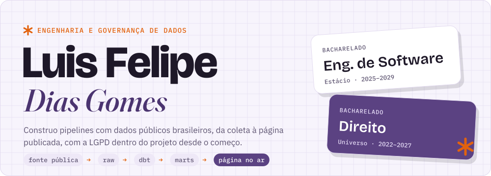
</picture>

  
  
  

Graduando em Engenharia de Software e em Direito, trabalho com Engenharia e Governança de Dados. Hoje sou Analista de Automação e Dados na JM L. Profissional. Cada projeto abaixo usa dados públicos, tem código aberto e uma página no ar com os resultados.

### Projetos

  <a href="https://github.com/LuissFellipe/energia-desperdicada"><picture><source media="(prefers-color-scheme: dark)" srcset="profile/energia-dark.svg">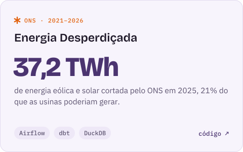</picture></a>
  <a href="https://github.com/LuissFellipe/estelionato-digital"><picture><source media="(prefers-color-scheme: dark)" srcset="profile/golpe-dark.svg">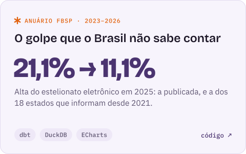</picture></a>
  <a href="https://github.com/LuissFellipe/ferrovias-br"><picture><source media="(prefers-color-scheme: dark)" srcset="profile/ferrovias-dark.svg">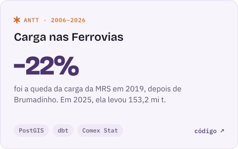</picture></a>
  <a href="https://github.com/LuissFellipe/queimadas-br"><picture><source media="(prefers-color-scheme: dark)" srcset="profile/queimadas-dark.svg">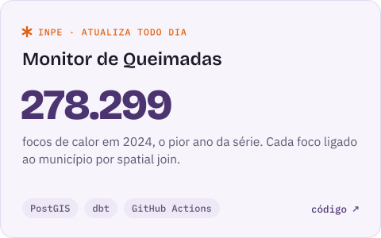</picture></a>
  <a href="https://github.com/LuissFellipe/consultor-indices"><picture><source media="(prefers-color-scheme: dark)" srcset="profile/indices-dark.svg">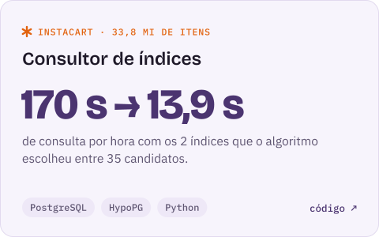</picture></a>
  <a href="https://github.com/LuissFellipe/salarios-dados"><picture><source media="(prefers-color-scheme: dark)" srcset="profile/salarios-dark.svg">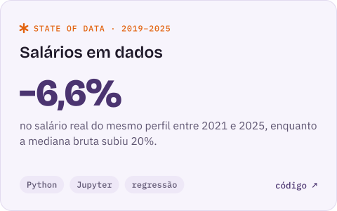</picture></a>
  <a href="https://github.com/LuissFellipe/pipeline-bcb"><picture><source media="(prefers-color-scheme: dark)" srcset="profile/bcb-dark.svg">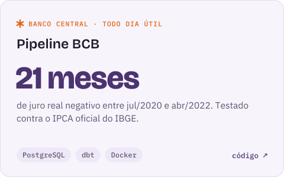</picture></a>
  <a href="https://github.com/LuissFellipe/analise-enem"><picture><source media="(prefers-color-scheme: dark)" srcset="profile/enem-dark.svg">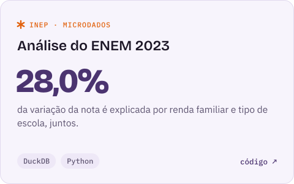</picture></a>

Também: [monitor de luz e água de Juiz de Fora](https://github.com/LuissFellipe/monitor-jf) com alertas no Telegram · [anonimização de dados para a LGPD](https://github.com/LuissFellipe/data-masking) · [grafo de editais de concurso](https://github.com/LuissFellipe/grafo-concursos) · [painel econômico em docker compose](https://github.com/LuissFellipe/painel-economico)

### Stack

<picture>
  <source media="(prefers-color-scheme: dark)" srcset="profile/stack-dark.svg">
  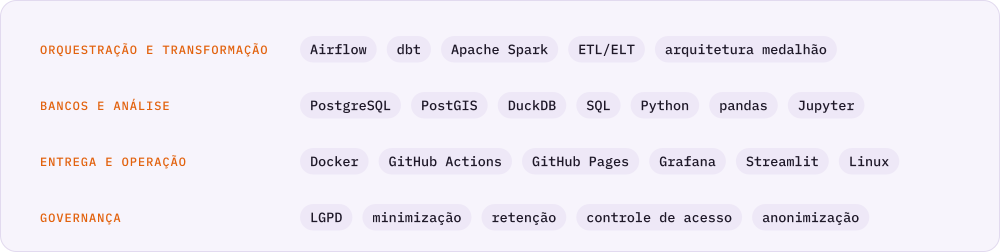
</picture>

### Formação e certificações

<picture>
  <source media="(prefers-color-scheme: dark)" srcset="profile/formacao-dark.svg">
  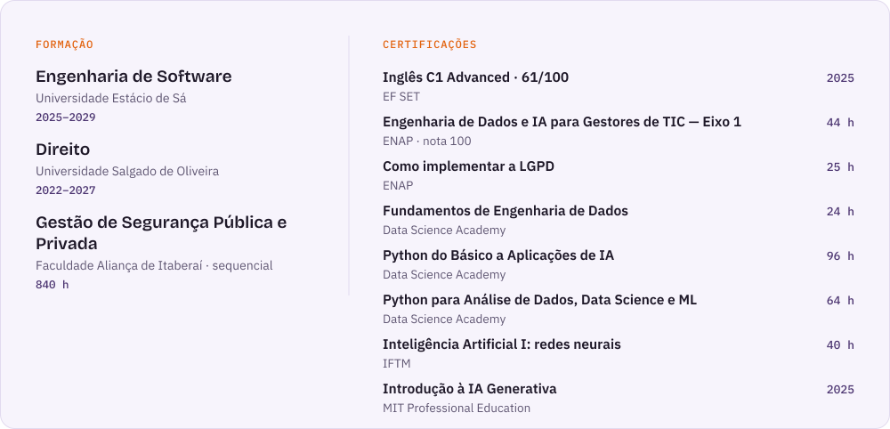
</picture>

Certificado de inglês verificável em [cert.efset.org/en/W1vNup](https://cert.efset.org/en/W1vNup).
