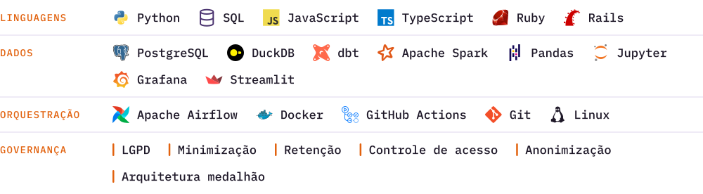

### Stack

<picture>
  <source media="(prefers-color-scheme: dark)" srcset="profile/stack-dark-compacta-4.svg">
  
</picture>

  
  
  

 

<picture>
  <source media="(prefers-color-scheme: dark)" srcset="profile/arcadius-dark-barra.svg">
  
</picture>

  

### Estatísticas

  <picture><source media="(prefers-color-scheme: dark)" srcset="https://github-readme-stats-three-virid-64.vercel.app/api?username=LuissFellipe&show_icons=true&layout=compact&disable_animations=true&card_width=450&locale=pt-br&bg_color=17121F&title_color=BDA4EC&text_color=F3EFFA&icon_color=FF8A3D&ring_color=BDA4EC&border_color=2F2640"></picture>
  <picture><source media="(prefers-color-scheme: dark)" srcset="https://github-readme-stats-three-virid-64.vercel.app/api/top-langs/?username=LuissFellipe&layout=compact&disable_animations=true&card_width=380&locale=pt-br&bg_color=17121F&title_color=BDA4EC&text_color=F3EFFA&icon_color=FF8A3D&ring_color=BDA4EC&border_color=2F2640"></picture>

### Formação e certificações

<picture>
  <source media="(prefers-color-scheme: dark)" srcset="profile/formacao-dark-3.svg">
  
</picture>

Certificado de inglês verificável em [cert.efset.org/en/W1vNup](https://cert.efset.org/en/W1vNup).
